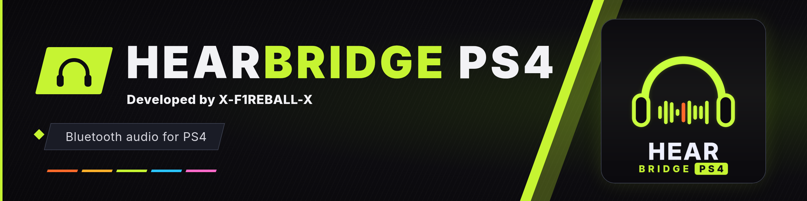
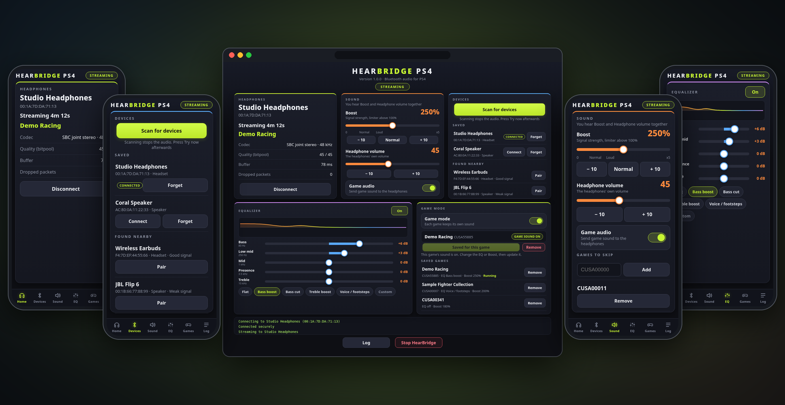
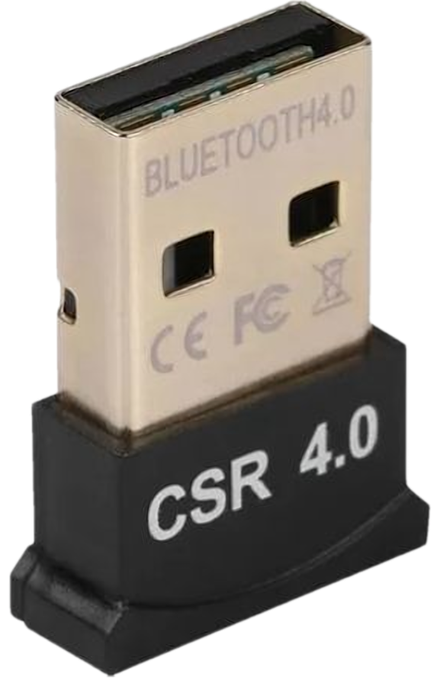
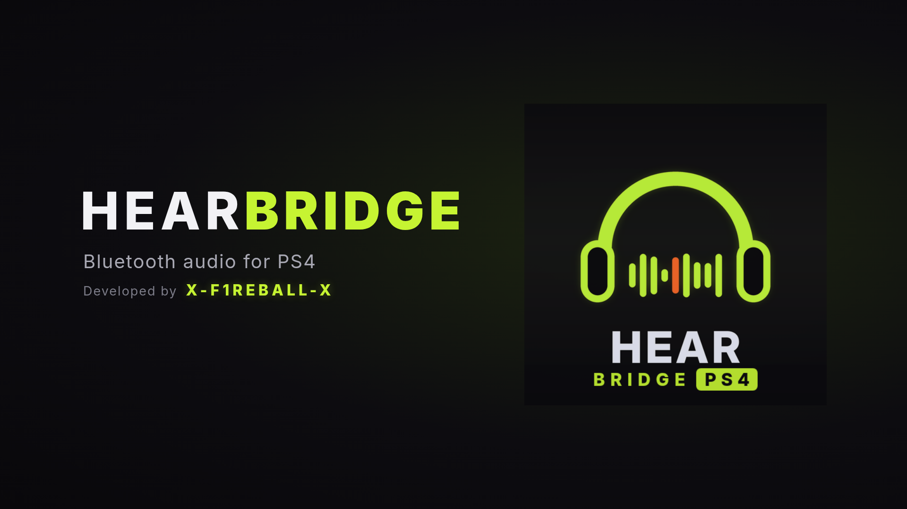

## BlueHEN native Bluetooth research (PS4 9.60)

This fork targets the PS4's **built-in Bluetooth**, generic A2DP Sink playback,
and microphone input from headsets that also support a two-way profile such
as HFP. **Native Bluetooth audio and microphone support are not implemented.**
An A2DP-only sink does not provide microphone input.

The first artifact is an inventory payload in `research/native-probe`.
See [the development handoff](research/NATIVE-HANDOFF.txt) for build commands,
test evidence, limitations and the next hardware gate. Do not use the upstream
launcher below expecting native Bluetooth or microphone support: that launcher
still requires a USB dongle and provides playback only.

The upstream HearBridge implementation and attribution follow unchanged.

<div align="center">



**Bluetooth audio for a jailbroken PS4: your game sound on regular wireless headphones.**

Developed by **X-F1REBALL-X**

</div>

**HearBridge family:** [PS5](https://github.com/X-F1REBALL-X/HearBridge-PS5) · [PS4](https://github.com/X-F1REBALL-X/HearBridge-PS4) · [Browser](https://github.com/X-F1REBALL-X/HearBridge-Browser)


HearBridge PS4 plays your PS4's game audio on ordinary Bluetooth headphones, earbuds or speakers. The console cannot do this by itself, so HearBridge drives a small USB Bluetooth dongle (CSR8510) and streams to any A2DP headset. You control everything from a web page served by the console, on a phone, a PC or the PS4 browser. It is the first Bluetooth audio solution for the PS4.



## Highlights

- Game audio on any Bluetooth headphones, earbuds or speakers.
- Scan, pair and connect from a web page. Up to 8 saved devices, with automatic reconnect.
- Headphone volume and a Boost slider for quiet games.
- Five band equalizer with presets.
- Game profiles: each game keeps its own sound, applied when the game starts.
- Switch game audio on or off, or skip games you do not want to stream.
- A launcher tile that sets everything up and starts the service.

## Requirements



- A jailbroken PS4 running GoldHEN, with the BinLoader server and Plugin Loader switched on.
- A USB Bluetooth dongle with the CSR8510 chip (USB ID 0A12:0001), plugged into the PS4. It looks like the one on the right.
- Bluetooth headphones, earbuds or a speaker.

<br clear="right">

## Install

1. Install **HearBridge-PS4.pkg** on the console with GoldHEN's package installer. A **HearBridge** tile appears on the home screen.
2. In the GoldHEN settings, turn on **BinLoader server** and **Plugin Loader**.
3. Plug the dongle into the PS4 and open the **HearBridge** tile. It installs the game audio plugin, starts the service and shows the page address. If it asks you to turn on Plugin Loader, do that and restart the console once.
4. Open **http://&lt;console-ip&gt;:8090** on a phone or PC on the same network, using the console's IP address. Or press OK on the tile message and then X (Circle if your console is set that way) to open the page in the PS4 browser.
5. Press **Scan for devices**, put your headphones in pairing mode and tap **Pair**.
6. Start a game. The sound plays on your headphones.

HearBridge keeps running after the tile closes and reconnects to your last headphones by itself.

Right after the first install you can already open the tile, pair your earbuds and set everything up. Restarting the console once afterwards is still recommended, so games start smoothly and do not get stuck in menus.

## Launcher

<p align="center"></p>

## Your controller stays connected

HearBridge does not affect your controller. The Bluetooth audio goes through the separate USB dongle, and HearBridge never touches the console's built-in Bluetooth chip, so your controllers stay connected as usual.

## Good to know

- Bluetooth adds a little delay, so the headphones play slightly behind the TV.
- Only game audio is streamed, not the home screen sounds or voice chat.
- Game audio is picked up from a game's main and background music outputs when they run at 48 kHz, which is what almost all games use. A game that opens its audio at another rate is not streamed.
- The launcher turns on **Plugin Loader** in GoldHEN's `config.ini` and adds the game audio plugin to `plugins.ini` under `[default]`. The first time it changes either file it keeps a copy as `config.ini.bak` or `plugins.ini.bak` next to it. It adds the plugin line again if you remove it.
- The page can be controlled by anyone who can open it on your network, so use it on a home network you trust. Commands only work from the page itself, not from other web sites.

## Uninstall

Delete the **HearBridge** app from the PS4. To remove everything it left behind, also delete `/data/GoldHEN/plugins/hearbridge_game_tap.prx`, the line for it in `/data/GoldHEN/plugins.ini`, the folders `/data/hearbridge` and `/data/GoldHEN/hearbridge`, and the files `hearbridge_skip.txt` and `hearbridge_tap_off` in `/data/GoldHEN`. Restart the console to stop a running HearBridge service.

## Build

You need the OpenOrbis PS4 toolchain, the PS4 payload SDK and the GoldHEN plugins SDK, and `clang`, `ld.lld` and Python 3. Point three variables at them:

```sh
export OO_PS4_TOOLCHAIN=/path/to/OpenOrbis/PS4Toolchain
export PS4_PAYLOAD_SDK=/path/to/ps4-payload-sdk
export GOLDHEN_SDK=/path/to/GoldHEN_Plugins_SDK
make launcher   # build/launcher/IV0000-HRBG40001_00-HEARBRIDGEPS4000.pkg
make test       # host tests, no SDK needed
```

The package also contains three system modules (`libc.prx`, `libSceFios2.prx` and `right.sprx`). They are not in this repository: the build copies them from the OpenOrbis toolchain (`src/modules` and `samples/dialogs`). If your toolchain keeps them elsewhere, set `SYS_LIBC`, `SYS_FIOS2` and `SYS_RIGHT` to their paths. `PkgTool.Core` needs OpenSSL 1.1; if your system has only a newer one, set `LIBSSL11` to a directory with `libssl.so.1.1`.

`make payload` builds the service alone and `make game-tap` the game audio plugin.

## Credits

Developed by **X-F1REBALL-X**. The equalizer comes from [HearBridge PS5](https://github.com/X-F1REBALL-X/HearBridge-PS5). Built with the OpenOrbis PS4 toolchain, the PS4 payload SDK and the GoldHEN plugins SDK. The system modules in the package belong to the OpenOrbis toolchain and are not covered by this project's license.

Big thanks to SiSTR0 for creating GoldHEN. HearBridge would not be possible without it.

Thank you to WOOfer for the coffee.

## License

GPL-3.0-or-later. See [LICENSE](LICENSE) and [NOTICE](NOTICE).
